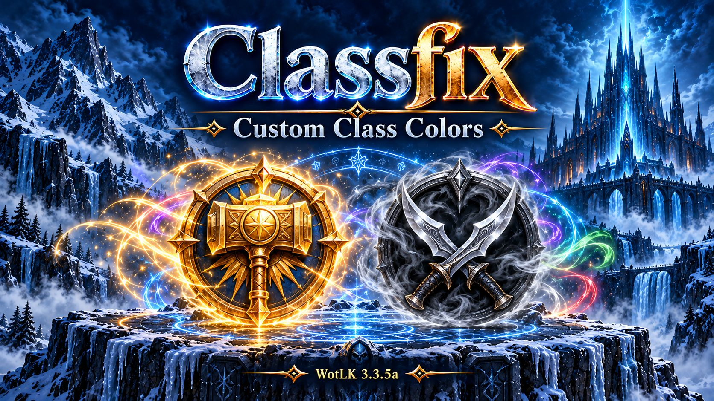

# Classfix

**Custom class colors for World of Warcraft: Wrath of the Lich King 3.3.5a.**

Classfix gives Paladins a gold class color and Rogues a neutral gray, while keeping the other classes at their Blizzard defaults. Prefer your own palette? Customize any class with the built-in color pickers or an exact hex value. Settings are saved account-wide.

| Class | Default color |
| --- | --- |
| Paladin |  Gold — `#F5B000` |
| Rogue |  Gray — `#808588` |
| All other classes | Original Blizzard Wrath colors |

## Download and install

1. [Download Classfix.zip](https://github.com/SuttonX/Classfix/releases/latest/download/Classfix.zip).
2. Extract the **!Classfix** folder into `World of Warcraft\Interface\AddOns`.
3. Restart WoW and enable **Classfix** on the character-selection AddOns screen.

The folder should contain `Interface\AddOns\!Classfix\!Classfix.toc`. Use one global class-color addon at a time.

## Customize your colors

Type `/classfix` or `/cf` to open the class color settings. Each class has its own color picker.

| Command | Action |
| --- | --- |
| `/classfix` or `/cf` | Open class color settings |
| `/classfix set rogue 808588` | Set a class to an exact six-digit RGB hex value |
| `/classfix default` | Apply the Classfix default palette |
| `/classfix blizzard` | Apply the original Blizzard Wrath palette |
| `/classfix status` | Show the running version and integration colors |

For exact-color commands, use the English class token, such as `paladin`, `mage`, or `deathknight`. A leading `#` on the hex value is optional.

Use `/reload` after changing colors so addons that cache their colors can refresh.

## Addon support

Classfix updates the shared `RAID_CLASS_COLORS` table and provides `CUSTOM_CLASS_COLORS`, including change callbacks for compatible addons.

Additional integrations include:

- **ElvUI for WotLK:** class-color tables, datatext accents, and normal buff/aura timers follow your selected colors. Debuff-type colors and special spell overrides remain separate.
- **Shadowed Unit Frames:** class-colored health bars, empty bars, and class-color text tags follow your selected palette, including after SUF profile changes. Pet and vehicle colors remain separate.

These integrations run through Classfix; you do not need to edit the other addons' files. Addons that use hardcoded colors or separate color systems may need individual support. Classfix does not turn normally uncolored elements into class-colored elements.

## Requirements

- Original WoW **3.3.5a** client (interface **30300**).
- No required addon dependencies.
- ElvUI and Shadowed Unit Frames are optional.

## More addons by SuttonX

- [SetupSwap](https://github.com/SuttonX/SetupSwap) — Switch addon sets and UI layouts between your desktop and controller setups.
- [ConsolePortLK-Enhanced](https://github.com/SuttonX/ConsolePortLK-Enhanced) — Controller support for WotLK with improved action bars, satellites, and cooldown displays.
- [FormFreedom](https://github.com/SuttonX/FormFreedom) — Automatically cancel druid forms when needed for supported interactions and actions.

## Credits and license

Derived from [Class Colors by Phanx](https://github.com/phanx-wow/ClassColors), copyright 2009–2018. The original license is included in [LICENSE.txt](LICENSE.txt). Classfix is an unofficial derivative with its own name, as required by that license.
